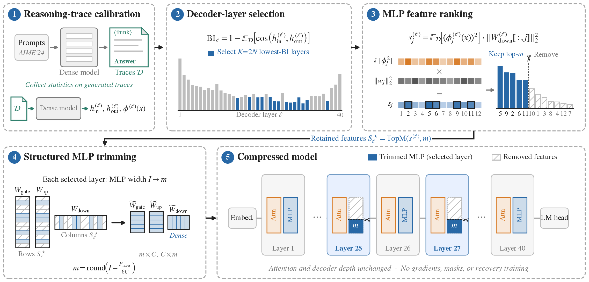

# Unlocking Structured Pruning for Reasoning Language Models via Attention-Preserving MLP Trimming

**LayerTrim** · Woosang Lim, Haneul Yoo, Vincent-Daniel Yun, Sungjoo Yoo · [Paper](https://arxiv.org/abs/2610.19121)

[](https://arxiv.org/pdf/2610.19121#page=4)

**LayerTrim** uses Block Influence to select decoder layers and narrows their MLPs by retaining the features with the largest expected squared contribution to the MLP output. It preserves attention and decoder depth. Accuracy is evaluated on the physically smaller checkpoint.

**Supported models** · Qwen3-14B (`qwen`), Phi-4-reasoning-plus (`phi`), and Magistral-Small-2506 (`magistral`).

## Data

We use 24 AIME 2024 reasoning traces per model for calibration.

## Main results

Table 1 of the [paper](https://arxiv.org/abs/2610.19121) reports mean accuracy (%) over three seeds. Budgets 7 and 9 correspond to trimming 14 and 18 MLPs, respectively. The paper used masked weights with vLLM 0.8.5. The commands below use the same selected neurons and evaluate physically trimmed checkpoints with Transformers.

| Model | Budget | AIME25 | AIME26 | GPQA-D | HumanEval | MBPP+ | Average |
|---|---|---:|---:|---:|---:|---:|---:|
| Qwen3-14B | Dense | 72.2 | 75.6 | 62.3 | 93.5 | 80.0 | 76.7 |
| | 7 | 64.4 | 60.0 | 49.7 | 90.2 | 77.2 | 68.3 |
| | 9 | 56.7 | 63.3 | 42.8 | 88.0 | 74.8 | 65.1 |
| Phi-4-reasoning-plus | Dense | 72.2 | 67.8 | 67.7 | 78.7 | 68.8 | 71.0 |
| | 7 | 60.0 | 60.0 | 53.0 | 74.6 | 63.3 | 62.2 |
| | 9 | 43.3 | 46.7 | 43.3 | 56.9 | 54.3 | 48.9 |
| Magistral-Small-2506 | Dense | 56.7 | 61.1 | 62.3 | 94.3 | 77.2 | 70.3 |
| | 7 | 30.0 | 42.2 | 52.2 | 90.7 | 73.8 | 57.8 |
| | 9 | 18.9 | 18.9 | 44.3 | 76.0 | 70.5 | 45.7 |

## Example commands

### Setup

The GPU environment uses NVIDIA RTX A6000 cards, Python 3.11, PyTorch 2.6.0 (CUDA 12.4), and Transformers 4.51.3.

```bash
conda create -n layertrim python=3.11 -y
conda activate layertrim
python -m pip install torch==2.6.0 --index-url https://download.pytorch.org/whl/cu124
python -m pip install -r requirements.txt
```

### Qwen3-14B on AIME 2025

```bash
python -m layertrim.data aime25
python -m layertrim.materialize assets/plans/qwen/n7.json --out checkpoints/qwen/n7
bash scripts/evaluate.sh qwen 7 aime25
```

The six plans in `assets/plans/` contain the layer and neuron indices from the experiments. To compute a fresh plan from the calibration traces, run `python -m layertrim.calibrate qwen --budgets 7 --device auto` and pass `plans/qwen/n7.json` to the materializer.

For the dense baseline, run `bash scripts/evaluate.sh qwen dense aime25`. Both commands use seeds 0, 1, and 2.

### Full evaluation

Accept the [GPQA access terms](https://huggingface.co/datasets/Idavidrein/gpqa) and authenticate with Hugging Face. Run generation in the GPU container.

```bash
python -m layertrim.data
SCORE_CODE=0 bash scripts/evaluate.sh qwen 7
```

Score HumanEval and MBPP+ from the same repository on the Docker host, with `data/` and `results/` shared with the GPU container.

```bash
docker build -f scripts/score-code.Dockerfile -t layertrim-scorer .
for seed in 0 1 2; do
  for task in humaneval mbpp; do
    bash scripts/score-code.sh "results/qwen/7/seed$seed" "$task"
  done
done
```

Run `python -m layertrim.summarize --results results` in the GPU container to print the five benchmark means.

## Citation

```bibtex
@article{lim2026layertrim,
  title={Unlocking Structured Pruning for Reasoning Language Models via Attention-Preserving MLP Trimming},
  author={Lim, Woosang and Yoo, Haneul and Yun, Vincent-Daniel and Yoo, Sungjoo},
  journal={arXiv preprint arXiv:2610.19121},
  year={2026}
}
```
